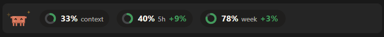

# Claude Status Bar (CSB)
n

A mod for the Claude desktop app. It adds one slim bar above the prompt:

- **Clawd** in the corner, reacting to what Claude does: thinking when you send a message, reading, writing or typing while tools run, done at the end of a turn. He looks worried when you burn through a limit too fast.
- **Three rings** with their value: context fill, the 5-hour limit and the weekly limit.
- **A pace delta** next to each limit, for example `5h 21% +11%`. It is the share of the window already elapsed minus the share used. Positive (green) means you are under an even pace and can use more. Negative (yellow, then red below -10) means you are using it too fast.

Everything comes from the engine's own usage readings: nothing is sent anywhere and no other program is run. The bar only shows once Claude has reported a rate-limit reading, so it needs a Claude subscription. It does not draw in the terminal, only in surfaces that can show SVG (the desktop app, VS Code, mobile).

## Install

In a terminal session of Claude Code:

```
/plugin install csb --marketplace prototype-xk/Claude-Status-Bar
```

Answer `y` to add the marketplace, then pick a scope.

## Credits and license

The Clawd drawing and animations (`src/clawd.ts`) are copied from [token-optimizer](https://github.com/alexgreensh/token-optimizer) by Alex Greenshpun. This repository is shared for non-commercial use under the [PolyForm Noncommercial License 1.0.0](LICENSE), which also carries the required notice. For commercial use, contact the original author.

Not affiliated with or endorsed by Anthropic. "Claude" and "Clawd" belong to their owners.
